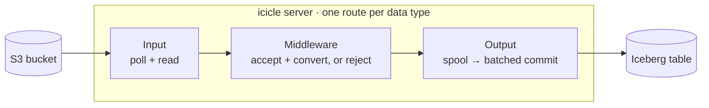
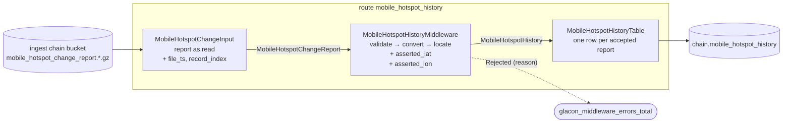

# icicle

`icicle` moves protobuf files from S3 into Iceberg tables. It is built on
[glacon](https://github.com/helium/glacon), the route runtime that also runs
the standalone icicle service for RADIUS and CDRs.

The service runs one or more **routes**, one per data type. Every route has
the same three stages:



| Stage | What it does |
|---|---|
| Input | Polls one bucket for a file prefix and hands each protobuf message on as a record. Validation and conversion belong in the middleware. |
| Middleware | Makes the route's decisions: for each record, either the record the output writes or why it was rejected. One result per record, in order. |
| Output | Turns records into rows of one Iceberg table, spools them to disk and commits them in batches. It creates the table on first start. |

glacon handles polling, batching, the ledger of processed files, replay after
a crash, and supervision. A route only provides its decoding, its middleware
and its table.

## Data

Each route has its own section here, its own module under `src/data/` and its
own section in the settings.

| Route | Source files | Table |
|---|---|---|
| [`mobile_hotspot_history`](#mobile_hotspot_history) | `mobile_hotspot_change_report` | `chain.mobile_hotspot_history` |

### `mobile_hotspot_history`

This route turns each `mobile_hotspot_change_report` written by the ingest
service into one row of `chain.mobile_hotspot_history`. In production the
table lives in the Iceberg catalog behind Trino's `mobile` catalog, so its
full name is `mobile.chain.mobile_hotspot_history`.

The rows are the ones `network.chain.mobile_hotspot_history` holds, plus two
columns: `asserted_lat` and `asserted_lon`, the center of the asserted H3
cell. Trino has no H3 functions, so dbt models can only measure distances
from an assertion if the center is already in the table.



The code is in `src/data/mobile_hotspot_history/`:

| Stage | Code | What it does |
|---|---|---|
| Input | [`input.rs`](src/data/mobile_hotspot_history/input.rs) | Makes no decisions. It hands each `MobileHotspotChangeReportV1` on untouched, with its `file_ts` and `record_index`. |
| Middleware | [`middleware.rs`](src/data/mobile_hotspot_history/middleware.rs) | Makes every decision: rejects, converts and locates (see below). |
| Output | [`output.rs`](src/data/mobile_hotspot_history/output.rs) | Writes one row per accepted report. It writes nothing for a rejected one. |

#### What the middleware does

`MobileHotspotHistoryMiddleware` returns one result per report, in order. It
holds no state, so a batch replayed after a crash gives the same results. Each
report goes through three steps:

1. **Validate.** A report is rejected if it has no report, no change or no
   metadata, or if a timestamp is out of range. glacon counts each rejection
   in `glacon_middleware_errors_total` and logs it. The reasons are
   `missing_report`, `missing_change`, `missing_metadata` and
   `invalid_timestamp`.
2. **Convert.** Each field becomes what the network table holds, the same way
   `glacon-rs` did it:
   - Timestamps become `timestamptz`.
   - `pub_key` becomes the Helium key string.
   - `animal_name` is derived from `pub_key`.
   - `asset` becomes bs58.
   - `device_type` becomes `CBRS`, `WIFI_INDOOR`, `WIFI_OUTDOOR`,
     `WIFI_DATA_ONLY` or `UNKNOWN`.
   - Empty `serial_number` and `asserted_hex` become NULL.
3. **Locate.** This is the one place H3 math happens.
   - `asserted_hex` is parsed, with or without a `0x` prefix, as an H3
     `CellIndex`.
   - The cell's center, from `h3o`, fills two columns: `asserted_lat` (its
     latitude) and `asserted_lon` (its longitude), both in degrees.
   - Both columns are left empty when there is no usable cell: either the
     hotspot is unasserted, or `asserted_hex` is not a valid H3 cell (which
     also logs a warning). The row is still written either way, since the
     network table keeps it too.

#### Table

The table is an event log: one row per chain update, not one row per hotspot.
It is partitioned by `day(timestamp)` and sorted by `pub_key`, then
`timestamp`.

| Column | Type | Meaning |
|---|---|---|
| `file_ts` | bigint | Time in the source file's name, in epoch milliseconds |
| `record_index` | bigint | Position of the report within its file |
| `received_timestamp` | timestamptz | When ingest received the change |
| `block` | bigint | Solana block of the change |
| `timestamp` | timestamptz | When the change took effect on chain |
| `pub_key` | varchar | Hotspot key |
| `animal_name` | varchar | Three-word name derived from `pub_key` |
| `asset` | varchar | Hotspot NFT, in bs58 |
| `serial_number` | varchar | Empty when not set |
| `device_type` | varchar | `CBRS`, `WIFI_INDOOR`, `WIFI_OUTDOOR`, `WIFI_DATA_ONLY` or `UNKNOWN` |
| `asserted_hex` | varchar | Asserted H3 cell. Empty when the hotspot is unasserted |
| `asserted_lat` | double | **New.** Latitude of the cell's center. Empty when there is no valid cell |
| `asserted_lon` | double | **New.** Longitude of the cell's center. Empty when there is no valid cell |
| `azimuth` | integer | Antenna azimuth |
| `signer` | varchar | Key that signed the change |

#### Settings

Settings for this route go under `[mobile_hotspot_history]`. It has one input,
named `chain`, and that name is the ledger's key, so don't rename it.
`start_after = "1970-01-01T00:00:00Z"` makes the first run read the whole
bucket.

## Adding a data type

1. Add a module `src/data/<route>/` with four pieces, using
   `mobile_hotspot_history` as the template:
   - an input (a `GlaconInput`) that only reads;
   - a middleware (a `GlaconCoreMiddleware`) that makes every decision,
     rejecting with a `GlaconRecordError` reason;
   - an output (a `GlaconOutput`);
   - a `route()` that wires them together.
2. Add an optional `<route>` section to `Settings` in `src/settings.rs`, and a
   branch for it in `src/cli/server.rs`.
3. Add its section to `pkg/settings-template.toml`.
4. Add a section for it under [Data](#data) in this README.

## Delivery

Delivery is at-least-once for every route. If the process crashes after an
Iceberg commit but before the spool file is removed, that batch is committed
again. `(file_ts, record_index)` identifies a source message, so deduplicate
on it before relying on row order, for example before a `lead()` over a
hotspot's history.

## Running

```sh
icicle -c settings.toml server
```

- **Settings.** `pkg/settings-template.toml` documents every key. Any key can
  also come from the environment: uppercase, prefixed with `ICICLE`, with
  `__` between levels. For example,
  `ICICLE__MOBILE_HOTSPOT_HISTORY__INPUTS__CHAIN__BUCKET__BUCKET=...`.
- **Which routes run.** A route runs only if its section is present, and the
  server refuses to start with none.
- **Durable volumes.** Each route's `route.state_dir` (the ledger) and
  `output.spool_dir` (rows not yet committed) must be on a durable volume.
  If a route's ledger is lost while its table holds data, startup refuses,
  unless that route sets `fresh_state = "proceed"`.
- **Metrics.** They are served on `metrics.endpoint` (default `0.0.0.0:19000`)
  and are all glacon's `glacon_*` series, labelled with `route`.

## Tests

```sh
cargo test -p icicle --lib
```

The integration tests need the services in the workspace `docker-compose.yml`
(RustFS, Polaris and Trino):

```sh
docker compose up -d --wait
cargo test -p icicle --test integrations
```
